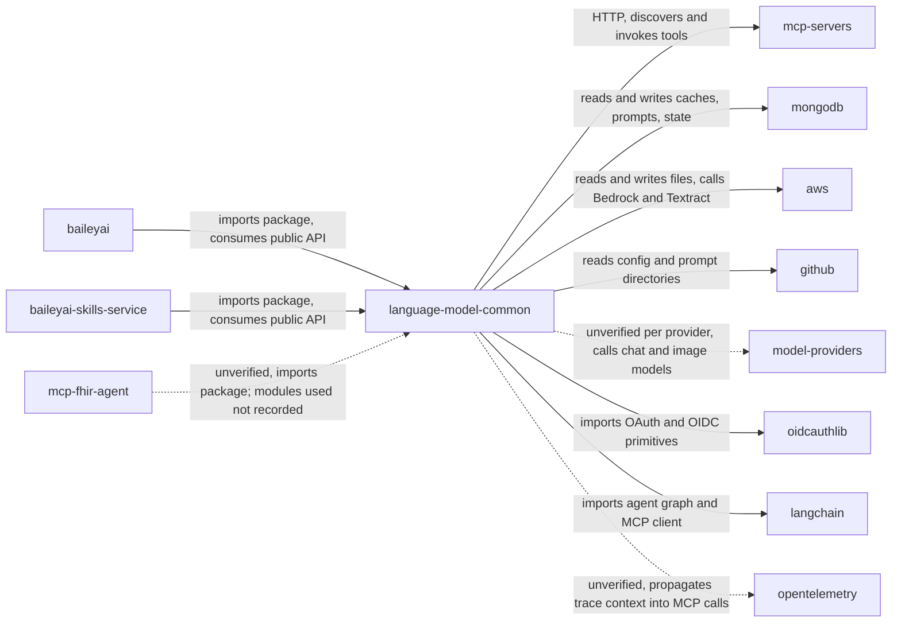

# Context diagram

Last verified: 2026-10-27 against 41304ee

Template version: 1

Question: who calls this repo and what does it call, one hop out?

RELATIONSHIPS.md is the source of truth; this diagram is derived from it.

Legend

- Arrow: points from the initiator of the connection to its target. The data direction is in the label (reads, writes, publishes, consumes, forwards caller token).
- Dashed line (-.->, flowchart only): the relationship is unverified. In sequence, state and ER diagrams the label "unverified" marks it.
- Label "gated: <ENV_VAR>": the relationship exists only when that setting is on. The line stays solid.
- Subgraph: groups nodes by environment or owning system only.

Rows covered: Upstream / baileyai; Upstream / baileyai-skills-service; Upstream / mcp-fhir-agent; Downstream / MCP servers; Downstream / MongoDB; Downstream / AWS; Downstream / GitHub; Downstream / Model providers; Downstream / oidcauthlib; Downstream / LangChain, LangGraph, `mcp` SDK; Downstream / OpenTelemetry

Not shown: which modules mcp-fhir-agent imports (unverified in RELATIONSHIPS.md); per-provider assumptions for model providers (unverified); the complaint-parser claim (no import or pin found, so it is not a recorded relationship); the "If you change X, check Y" guidance, which stays in the tables.

Next: [RELATIONSHIPS.md](../RELATIONSHIPS.md)
